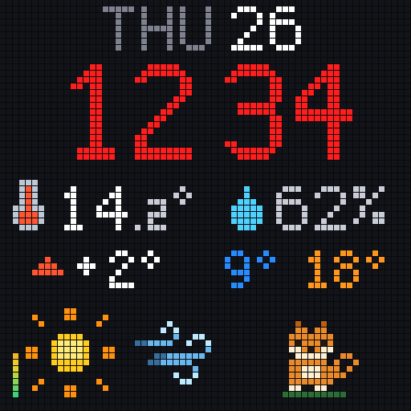
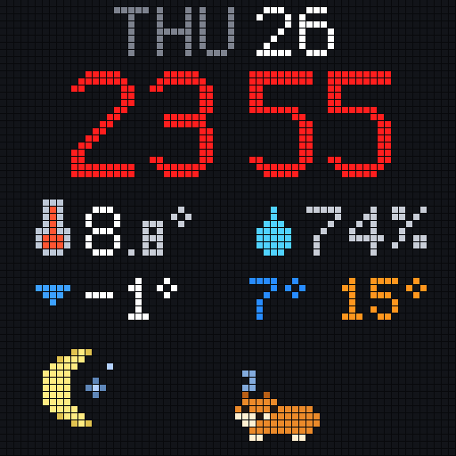
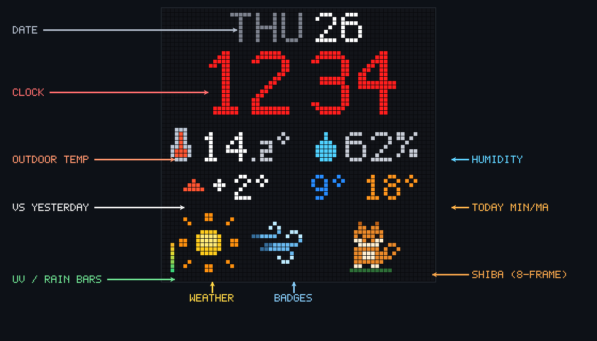
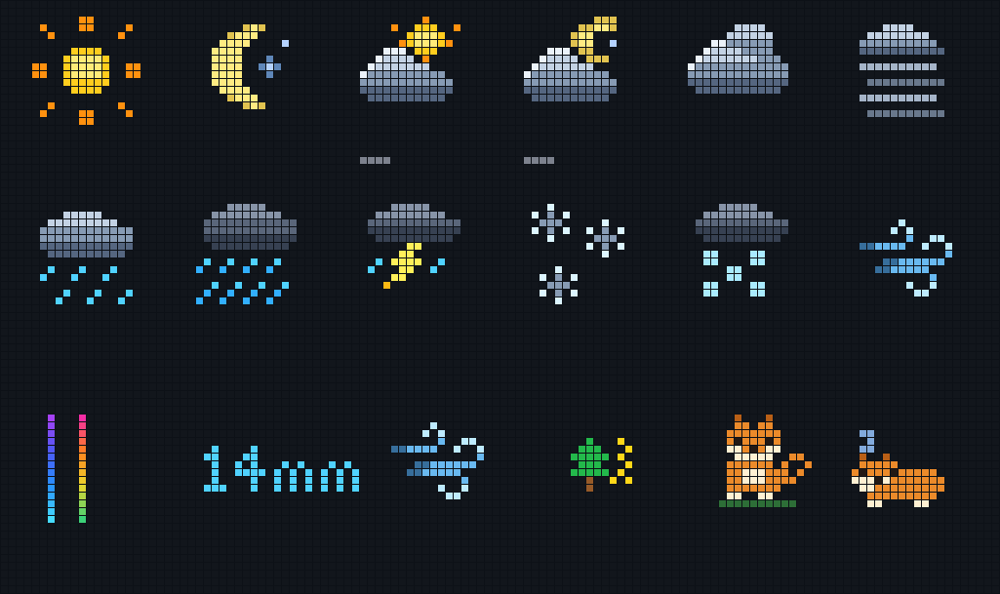

# Divoom Pixoo-64 ESPHome Weather & Clock Dashboard

Custom ESPHome firmware and Home Assistant templates for the **Divoom Pixoo-64** (`64×64` RGB LED matrix), featuring pixel-accurate custom typography, weather icons, adaptive room-light dimming, and an animated Shiba Inu companion.

| Daytime (UV + Sun + Wind + Sitting Shiba) | Nighttime (Crescent Moon + Sleeping Shiba) |
| :---: | :---: |
|  |  |

### Layout Breakdown

### Weather Icons, Bars & Badges

## Features

- **5-Row `64×64` Pixel-Locked Layout (`pixoo_bitmaps.h`):**
  - **Row 1:** Day of week & date (`5×7` bitmap font).
  - **Row 2:** Hero clock (`9×15` rounded sans digits, `HH   MM`).
  - **Row 3:** Outdoor temperature (`5×8` thermometer icon) & humidity (`5×7` droplet icon), centered in 50/50 columns.
  - **Row 4:** Day-over-day temperature trend (`%+d°` vs. yesterday's daytime peak) & today's min/max range (`4×6` micro font).
  - **Row 5:**
    - `1×14 px` smooth gradient vertical bars on the left (`X=0` Rain `mm`, `X=2` daytime UV index).
    - `14×14` primary weather icon (12 conditions: sun, crescent moon, partly cloudy day/night, cloudy, fog, rain, pouring, thunderstorm, 3-snowflake snow, hail, wind).
    - Secondary badges on the right (rain `mm`, strong wind, cedar pollen), with an **8-frame animated Shiba Inu** (walking back and forth during the day, curled up sleeping at night) automatically filling the empty space whenever no—or few—badges are active.
- **2-Stage Adaptive Dimming:**
  - Combines hardware panel brightness (`light: platform: pixoo`, `1%–90%`) with software RGB scaling (`DimmingDisplay`) and warm night-tint below `15%` RGB so the display can go far dimmer than the stock `1%` hardware floor during late-night hours (`22:00–07:30`), while responding immediately when bedroom lighting turns on.

## Files

- `pixoo64.yaml` — ESPHome device configuration (`esp-idf`, `pixoo` display & light platform, Home Assistant API sensors).
- `pixoo_bitmaps.h` — C++ pixel-art renderer (`9×15` clock, `5×7` & `4×6` bitmap fonts, weather icons, gradient bars, Shiba Inu sprites, `DimmingDisplay`).
- `homeassistant_templates.yaml` — Home Assistant template sensors (`sensor.pixoo_forecast_engine`, `pixoo_temp_diff`, `pixoo_temp_min`, `pixoo_temp_max`, `pixoo_precip_max`, `pixoo_alert_pollen`).
- `secrets.yaml.example` — Template for ESPHome `secrets.yaml` (`wifi_ssid`, `wifi_password`, `ota_password`).

## Setup

### 1. First-Time Hardware Flashing (Required Once)

The stock Divoom firmware does not support OTA flashing of custom firmware, so **the initial ESPHome flash must be done over serial/UART**:

1. **Disassemble the enclosure** carefully to expose the mainboard and its labeled UART programming pads (`GND`, `TX`, `RX`, `IO0`, `EN`, `VCC`).
2. **Connect a USB-to-Serial adapter** by either:
   - **Pogo-pin tools / clamp adapters** (recommended — no permanent soldering required), or
   - **Soldering temporary leads** to the UART pads.
   - *Tip:* Factory boards often have flux residue on the test pads; clean them with isopropyl alcohol if pogo pins don't make reliable contact, and make sure the internal Wi-Fi antenna connector is firmly seated before reassembly.
3. *(Optional)* Back up the stock firmware first using `esptool.py` (`read_flash 0x0 0x400000`).
4. Flash the initial ESPHome firmware over USB-Serial. After that, all future updates can be installed wirelessly via OTA.

**Useful Resources:**
- [ESPHome Pixoo Display Component Docs](https://esphome.io/components/display/pixoo/)
- [ESPHome Pixoo Light (Brightness) Docs](https://esphome.io/components/light/pixoo/)
- [Espressif `esptool` Documentation](https://docs.espressif.com/projects/esptool/)

### 2. Home Assistant & Configuration

1. Add the template sensors from `homeassistant_templates.yaml` to your Home Assistant `configuration.yaml` (and adjust entity IDs in `pixoo64.yaml` to match your weather/illuminance/light entities).
2. Copy `secrets.yaml.example` to `secrets.yaml` and fill in your Wi-Fi and API encryption key.
3. Copy `pixoo64.yaml`, `pixoo_bitmaps.h`, and `secrets.yaml` into your ESPHome config directory and install wirelessly.
